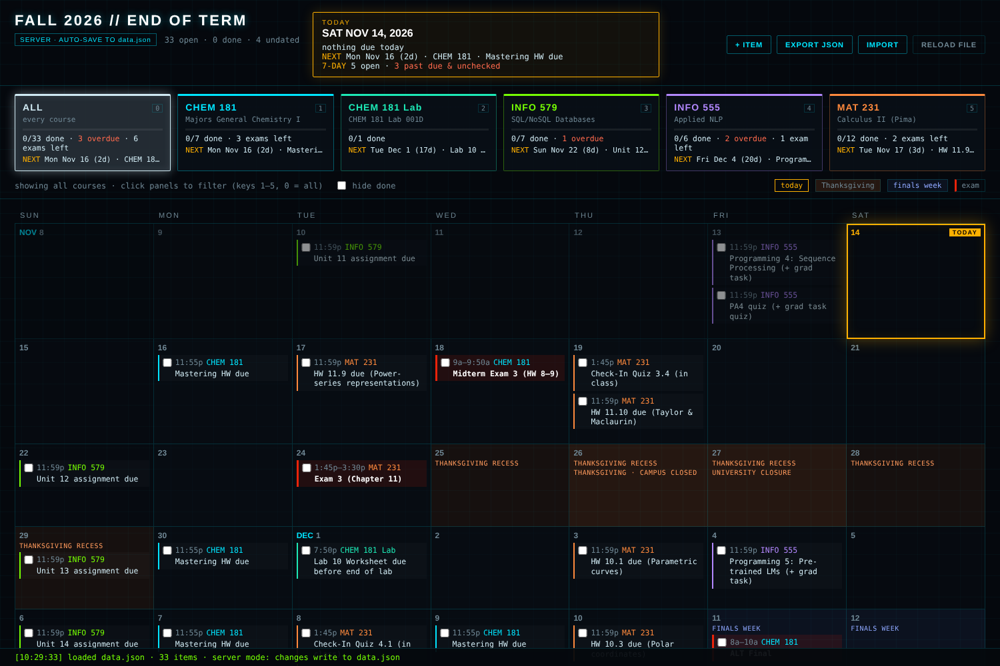

# fall26-calendar

End-of-term calendar for Fall 2026 (Nov 8 – Dec 19): homework, deliverables, exams and projects across CHEM 181, INFO 555, INFO 579 and MAT 231. Static HTML/CSS/JS front end; all content lives in one editable `data.json`.



## Features
- Sun–Sat calendar grid, check-off boxes, click-to-edit / add / delete
- TODAY box: due today, next open item with days left, 7-day count; today's cell highlighted
- Shaded periods: Thanksgiving recess / closures, finals week
- Course panels across the top (ALL + one per course): progress bar, done/overdue counts, exams left, next due item. Click one or several to show only those courses on the calendar and in the TODAY box; ALL / SHOW ALL clears. Keys `1`–`5` toggle, `0` = all. Selection is remembered per browser.
- "hide done" filter
- Undated items panel (assign a date to move onto the grid)
- Status line logs every load / save / failure

## Run locally — edits write to `data.json`
```
python serve.py                 # http://127.0.0.1:8555 (next free port if busy)
python serve.py --port 9000 --no-browser
```
Standard library only. Every change is POSTed to `/api/save`, written atomically to `data.json`; the previous version is kept as `data.json.bak` (git-ignored). Commit `data.json` when you want a snapshot.

## GitHub Pages (read-only host)
Settings → Pages → Deploy from branch → `main` / root. `.nojekyll` is included.
On Pages there is no save server: changes are kept as a browser draft (badge turns amber). **EXPORT JSON** downloads the updated `data.json` to commit; **RELOAD FILE** discards the draft.
Opening `index.html` via `file://` can't fetch `data.json` — use `serve.py` or **IMPORT**.

## `data.json` schema
| key | meaning |
|---|---|
| `meta.start`, `meta.end` | range shown (snapped to whole Sun–Sat weeks) |
| `courses` | `code → {color, name}`; drives legend chips and item colors |
| `types` | suggestions for the Type field |
| `periods` | shaded ranges `{id, kind: break\|closure\|finals, label, start, end}` |
| `items` | `{id, date (YYYY-MM-DD or null), time, end, course, type, title, location, notes, done}` — a `type` starting with `EXAM` gets exam styling |

## Files
```
index.html   page shell
style.css    TRON Ares dark theme
app.js       load / render / edit / save logic
data.json    all calendar content
serve.py     local static server + /api/save
docs/        screenshot
```

## Sources for the dates
CHEM 181 lecture syllabus and lab schedule v1.0 / lab syllabus v1.3; Pima MAT 231 Schedule of Work; INFO 555 / INFO 579 syllabi; UA Registrar Fall 2026 final-exam schedule (exam period Dec 11–17). INFO 555 final uses the registrar slot for MW 3:30 classes (syllabus says the exam is posted to D2L — confirm). MAT 231 final time not given; class slot assumed.
